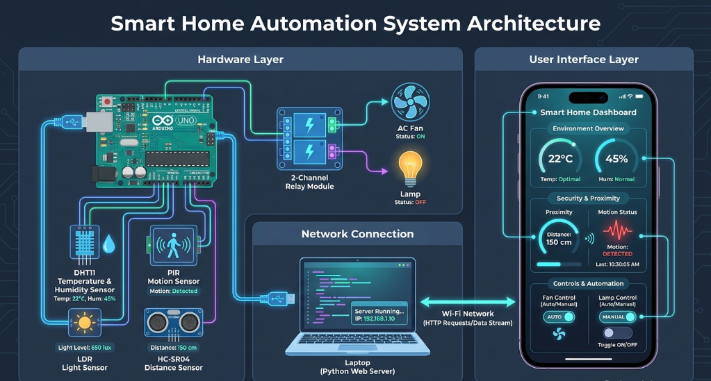

# XENOX — Facility Automation & Building Management System


A comprehensive, commercial-grade **Facility Automation & Telemetry Console** built on an **Arduino UNO** microcontroller with sensor-driven climate and lighting logic, dual-channel AC relay switching, doorway proximity clearance tracking, and dedicated mobile smartphone integration.

Tailored for **Hospital, Hotel, and Commercial Building Managers**.

---

## 🏗️ System Architecture



### 1. Hardware Layer
- **Arduino UNO (ATmega328P)**: Central microcontroller executing autonomous room switching algorithms.
- **DHT11 Sensor (Digital Pin D2)**: Indoor air temperature & relative humidity monitoring (ASHRAE / NABH comfort compliance).
- **PIR Occupancy Sensor (Digital Pin D3)**: Infrared human presence and room occupancy detection (Guest / Patient / Staff tracking).
- **LDR Light Sensor (Analog Pin A0)**: Ambient daylight harvesting level detection (Energy-efficient illumination gating).
- **HC-SR04 Sensor (Trig D6 / Echo D7)**: Ultrasonic doorway clearance & entrance traffic proximity monitor.
- **2-Channel Relay Module**:
  - **Relay Channel 1 (Pin D8)**: AC Ventilation / Fan Coil Unit (FCU) / Ceiling Fan.
  - **Relay Channel 2 (Pin D9)**: Zone Room Lighting.
- **Status LED (Pin D13)**: Microcontroller heartbeat and serial state indicator.

### 2. Network & Gateway Layer
- **Building Gateway (`server.py`)**: Python HTTP and Serial bridge communicating with Arduino UNO at **115200 baud** over USB.
- Serves REST endpoints (`/api/status`, `/api/relay`, `/api/mode`) and delivers both the Web Console and Mobile App over the local Wi-Fi network.

### 3. User Interface Layer
- **Desktop Web Management Console**: Facility dashboard with room zone selector (Hotel Suite, Hospital Ward, Corporate Office, Corridor), circular gauges, doorway clearance bar, multi-sensor timeline, setpoint calibration, ESG energy model, and event audit log.
- **Dedicated Smartphone App**: Native-styled mobile app built specifically for mobile screens, matching the mobile interface in the architecture diagram.

---

## 📱 Mobile Smartphone Application

The mobile phone application is available in two ready-to-run formats:

1. **Instant Web Mobile App (PWA)**:
   - Located at: [`mobile/index.html`](mobile/index.html)
   - Open on any phone or browser. Tap **"Add to Home Screen"** on iOS or Android for a full native app experience.
   - Accessible over local Wi-Fi at: `http://<YOUR_COMPUTER_IP>:8000/mobile/index.html`

2. **Native React Native / Expo Mobile Project**:
   - Located in the [`mobile-app/`](mobile-app/) directory.
   - Run with `npx expo start` to test on your iPhone or Android with Expo Go, or build a native `.apk`.

---

## ⚡ Quick Start (Running the System)

### Option A: Open Directly in Web Browser
- **Desktop Facility Console**: Open [`index.html`](index.html).
- **Phone App**: Open [`mobile/index.html`](mobile/index.html).

### Option B: Run with the Python Gateway (For real Arduino & Wi-Fi mobile access)
```bash
cd "C:\Users\mnvpa\.gemini\antigravity\scratch\xenox-smart-automation"
python server.py
```
- Open **`http://localhost:8000`** for the Desktop Console.
- Open **`http://localhost:8000/mobile/index.html`** on mobile phones connected to your local Wi-Fi network.

---

## 🔌 Hardware Wiring Pinout

| Module / Sensor | Arduino UNO Pin | Function | Logic |
| :--- | :--- | :--- | :--- |
| **DHT11 Data** | **Digital D2** | Room Temperature & Humidity | OneWire Protocol |
| **PIR Out** | **Digital D3** | Room Occupancy Detection | HIGH = Occupied, LOW = Vacant |
| **LDR Analog Out** | **Analog A0** | Ambient Natural Light | 0 to 1023 ADC (0–100%) |
| **HC-SR04 Trig** | **Digital D6** | Ultrasonic Trigger pulse | 10µs HIGH pulse |
| **HC-SR04 Echo** | **Digital D7** | Ultrasonic Echo return | Pulse duration timing |
| **Relay CH1 (IN1)** | **Digital D8** | Ventilation / Fan Actuator | Active LOW (LOW = ON) |
| **Relay CH2 (IN2)** | **Digital D9** | Zone Room Lighting Actuator | Active LOW (LOW = ON) |
| **Status LED** | **Digital D13** | System Heartbeat indicator | Toggle every 500ms |

---

## 🧠 Facility Decision & Automation Rules

1. **Ventilation / Cooling Automation**:
   - **Condition**: If `Room Temperature >= Cooling Setpoint` (Default: **28.0°C** or per-profile), Relay CH1 energizes (Fan/FCU turns **ON**).
   - Once cooled below the setpoint, Relay CH1 de-energizes (Fan turns **OFF**).

2. **Lighting Automation**:
   - **Condition**: Relay CH2 turns **ON** only when:
     1. `Room Occupancy == OCCUPIED` (or within hold window, default **30s**), **AND**
     2. `Natural Daylight < Darkness Limit` (Default: **40%**).
   - Prevents electrical waste during daylight hours or when rooms/wards are vacant.

3. **Doorway Clearance & Entryway Traffic**:
   - Monitored via the HC-SR04 ultrasonic sensor with a linear clearance meter and traffic log ($< 50\text{ cm}$ traffic approach).

4. **Facility Manager Override**:
   - Switching to **Manual Mode** from either the Desktop Console or Mobile App allows direct override control of ventilation and lighting feeds.
